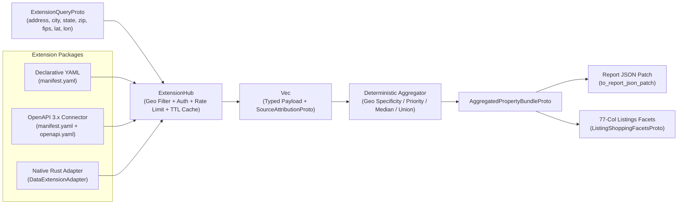

# Open Estate Modular Extension Architecture

Open Estate uses a **Home-Assistant-style modular integration registry** combined with **Airbyte-inspired declarative YAML / OpenAPI 3.x stream execution** and a **typed Protocol Buffers (`proto3`) schema bridge**. Community contributors and operators can add new municipal utilities, regional fiber carriers, county tax schedules, and public/commercial property APIs purely by dropping a declarative `manifest.yaml` (plus an optional `openapi.yaml`) into `extensions/<extension_id>/` or installing it live from the `/admin` console—without writing or recompiling Rust code.

---

## 1. Architectural Synthesis: Home Assistant + Airbyte + Protobuf

| Architectural Layer | Inspiration | Role in Open Estate |
| :--- | :--- | :--- |
| **Package Discovery & Governance** | **Home Assistant `manifest.json`** | Every integration declares identity (`extension_id`, `name`, `version`, `codeowners`), capability `domain`, `driver`, `geo_scope`, `auth`, `default_provenance`, `priority`, and `enabled` state in `extensions/<extension_id>/manifest.yaml`. Managed at runtime via `ExtensionHub` and `/admin`. |
| **Zero-Code Connector Execution** | **Airbyte Low-Code `DeclarativeStream`** | `manifest.yaml` (paired optionally with `openapi.yaml`) defines the actual execution logic: HTTP endpoint/operation binding, `minijinja` request templating, RFC 9535 JSONPath `response_mapping`, and geo-scoped `static_tariffs` / `geo_rules` catalogs. |
| **Canonical Wire & Merge Contract** | **Protocol Buffers (`openestate.extension.v1`)** | Every connector—whether Declarative YAML, OpenAPI 3.x, or Native Rust—emits typed `ExtensionEnvelopeProto` messages. `aggregator.rs` deterministically merges envelopes into `AggregatedPropertyBundleProto` for report JSON patching and 77-column `listings` shopping facet indexing. |
| **Binary / Spatial Escape Hatch** | **Native Rust Trait (`DataExtensionAdapter`)** | Reserved strictly for binary, streaming, or heavy computational protocols where HTTP+JSONPath does not apply (e.g., USGS 3DEP airborne LiDAR `.laz` point-cloud triangulation via `las`). |



---

## 2. Open-Source Rust Crate Selection & Rationale (`edition = "2021"`)

All crates selected for the extension engine are permissive open-source (`MIT` or `Apache-2.0`), compatible with `edition = "2021"`, and require **zero external system binaries** (no system `protoc` or C/C++ toolchains required).

### New Extension Engine Crates

| Crate | Recommended Version | License | Rationale & Engineering Notes |
| :--- | :--- | :--- | :--- |
| `prost` | `0.14` | Apache-2.0 | Industry-standard, zero-copy-capable Rust Protocol Buffers runtime generating clean idiomatic structs and `oneof` enums from `proto3`. |
| `prost-types` | `0.14` | Apache-2.0 | Standard descriptor types (`FileDescriptorSet`) shared between `protox` and `prost-build`. *(Keep `prost`, `prost-types`, and `prost-build` on the same `0.14` minor line).* |
| `prost-build` *(build-dep)* | `0.14` | Apache-2.0 | Compiles `FileDescriptorSet` into `$OUT_DIR/openestate.extension.v1.rs` with `#[derive(serde::Serialize, serde::Deserialize)]` attributes for dual binary-wire + JSON bridging. |
| `protox` *(build-dep)* | `0.10` | MIT / Apache-2.0 | **Pure-Rust `protoc` compiler frontend** (`protox 0.10` targets `prost-types ^0.14.0`). Eliminates any host dependency on a pre-installed `protoc` binary during `cargo check` / `cargo build` / Docker builds. |
| `serde_yaml_ng` *(or `serde_yml`)* | `0.10` *(or `0.0.13`)* | MIT / Apache-2.0 | Parses `manifest.yaml` and `openapi.yaml`. **Advisory note**: prefer `serde_yaml_ng = "0.10"` (clean maintained continuation of `serde-yaml`) or `serde_yml = "0.0.13"` (safe shim; avoid `serde_yml <= 0.0.12` due to `RUSTSEC-2025-0068`). |
| `openapiv3` | `2.2` | MIT / Apache-2.0 | Strongly typed Rust AST for OpenAPI 3.0.x specifications (`OpenAPI`, `Paths`, `Operation`, `Parameter`, `Server`), deserialized directly from `openapi.yaml` via `serde`. |
| `serde_json_path` | `0.7` | MIT | Pure-Rust implementation of **IETF RFC 9535 JSONPath**. Chosen over legacy `jmespath` because RFC 9535 is standardized, supports filter selectors (`$[?@.technology == '50']`), and queries `&serde_json::Value` directly without intermediate AST allocation. |

### Existing Workspace Crates Reused (`Cargo.toml`)

- **`minijinja` (`3.1`)**: Sandboxed template evaluation for URL paths, query parameters, headers, and JSON request bodies (`{{ lat }}`, `{{ lon }}`, `{{ zip }}`, `{{ state }}`, `{{ city }}`, `{{ county_fips }}`, `{{ address }}`).
- **`reqwest` (`0.12`, `rustls-tls`) + `backon` (`1.6`)**: Async HTTPS execution with exponential backoff and retry budgets driven by `RateLimitSpecProto`.
- **`governor` (`0.10`)**: Per-extension lock-free GCRA rate limiting (`requests_per_second`, `burst`).
- **`moka` (`0.12`) + `dashmap` (`6`)**: Async concurrent response cache honoring each manifest's `cache_ttl_secs`, plus lock-free `ExtensionHub` state lookup.
- **`sea-query` (`1.0`) + `sqlx` (`0.8`)**: Dialect-portable SQLite WAL + MySQL 8.4/9.0 storage for `installed_extensions`, `system_modules`, `listings`, and `admin_audit_log`.

### Pure-Rust `build.rs` Compilation Pattern

```rust
fn main() -> Result<(), Box<dyn std::error::Error>> {
    let proto_files = [
        "proto/openestate/extension/v1/domains.proto",
        "proto/openestate/extension/v1/extension.proto",
        "proto/openestate/extension/v1/aggregation.proto",
    ];
    for p in &proto_files {
        println!("cargo:rerun-if-changed={p}");
    }

    let file_descriptors = protox::compile(proto_files, ["proto"])?;
    let mut config = prost_build::Config::new();
    config.type_attribute(".", "#[derive(serde::Serialize, serde::Deserialize)]");
    config.type_attribute(".", "#[serde(rename_all = \"camelCase\")]");
    config.compile_fds(file_descriptors)?;
    Ok(())
}
```

> [!TIP]
> All three `.proto` files avoid `google.protobuf.Timestamp` and `google.protobuf.Struct` in favor of RFC 3339 strings and typed messages so `#[derive(serde::Serialize, serde::Deserialize)]` compiles cleanly across every generated type without `prost-types` orphan-trait workarounds.

---

## 3. Protobuf Schema Bridge (`proto/openestate/extension/v1/`)

All three IDL files belong to `package openestate.extension.v1;` and form a strict acyclic dependency graph (`domains.proto` $\leftarrow$ `extension.proto` $\leftarrow$ `aggregation.proto`), compiling into a single cohesive Rust module (`openestate.extension.v1.rs`):

1. **[domains.proto](../proto/openestate/extension/v1/domains.proto)** — Canonical domain contracts:
   - Utilities & Connectivity: `ElectricUtilityProto`, `GasUtilityProto`, `WaterSewerTrashProto`, `BroadbandOptionProto`, `BroadbandCatalogProto`.
   - Core Property Intelligence: `GeocodeResultProto`, `PropertyFactsProto`, `HazardSummaryProto`, `EnvironmentalSummaryProto`, `LivabilitySummaryProto` (+ `SchoolSummaryItemProto`), `MarketValuationProto`, `InsuranceQuoteProto`, `TaxMandatesProto`, `House3dMetadataProto`, `ListingsFeedBatchProto`.
   - Shopping Database Bridge: `ListingShoppingFacetsProto` — maps 1-to-1 onto all 27 `LISTINGS_SHOPPING_UPGRADE_COLS` plus core hazard/school/valuation columns in the 77-column `listings` table. Every nullable scalar uses `proto3` `optional` (`Option<T>` in Rust) so missing values remain `None` / SQL `NULL`.
2. **[extension.proto](../proto/openestate/extension/v1/extension.proto)** — Extension metadata & runtime envelope:
   - `CapabilityDomain` (18 variants covering geocode, property facts, valuation, market trends, electric/gas/water utilities, broadband, hazards, environmental, livability, schools, crime, 3D massing, listings feed, insurance, and tax mandates).
   - `DriverKind` (`DRIVER_DECLARATIVE_YAML`, `DRIVER_OPENAPI_YAML`, `DRIVER_NATIVE_ADAPTER`).
   - `ProvenanceTier` (`PROVENANCE_LIVE_VERIFIED`, `PROVENANCE_OFFICIAL_TARIFF`, `PROVENANCE_REGIONAL_FOOTPRINT`).
   - `GeoScopeProto`, `AuthSpecProto`, `RateLimitSpecProto`, `ExtensionManifestProto`, `SourceAttributionProto`, `ExtensionQueryProto`, and `ExtensionEnvelopeProto` (`oneof payload`).
3. **[aggregation.proto](../proto/openestate/extension/v1/aggregation.proto)** — Multi-vendor resolution contracts:
   - `MergeStrategy` (`MERGE_HIGHEST_PRIORITY`, `MERGE_GEO_MOST_SPECIFIC`, `MERGE_CONSENSUS_MEDIAN`, `MERGE_UNION_DEDUP`).
   - `DomainAggregationPolicyProto`, `DomainResolutionTraceProto`, and `AggregatedPropertyBundleProto`.

---

## 4. Declarative YAML & OpenAPI 3.x Connector Specification

Each extension lives in `extensions/<extension_id>/manifest.yaml` (with an optional `extensions/<extension_id>/openapi.yaml` for `DRIVER_OPENAPI_YAML`).

### 4.1 Pattern A: OpenAPI 3.x Live API Connector (`driver: openapi_yaml`)

Used when an upstream agency or vendor publishes an OpenAPI 3.0 specification (e.g., U.S. Census Geocoder, FCC Broadband Data Collection, USGS ASCE 7-22 Seismic, EPA SDWIS). `yaml_runner.rs` resolves the server URL, HTTP method, path template, and parameter locations (`query`, `path`, `header`) directly from `openapi.yaml` via `operation_id`, then extracts fields using RFC 9535 JSONPaths.

```yaml
# extensions/usgs_asce7_seismic/manifest.yaml
extension_id: usgs_asce7_seismic
name: USGS ASCE 7-22 Seismic Design Maps
version: "1.0.0"
description: Live site-class seismic design parameters (PGA, Ss, S1, SDC) from USGS Earthquake Hazards Program.
domain: DOMAIN_NATURAL_HAZARDS
driver: DRIVER_OPENAPI_YAML
proto_message_type: openestate.extension.v1.HazardSummaryProto
openapi_spec_file: openapi.yaml
documentation_url: https://earthquake.usgs.gov/ws/designmaps/asce7-22.html
codeowners: ["@openestate-core"]
default_provenance: PROVENANCE_LIVE_VERIFIED
priority: 120
enabled: true
builtin: true
cache_ttl_secs: 604800 # 7 days

geo_scope:
  nationwide: true

auth:
  auth_type: none

rate_limit:
  requests_per_second: 5
  burst: 10
  timeout_ms: 4000
  max_retries: 2

openapi_operation:
  operation_id: getAsce722DesignParameters
  parameters:
    latitude: "{{ lat }}"
    longitude: "{{ lon }}"
    riskCategory: "II"
    siteClass: "D"
    title: "Open Estate"

response_mapping:
  root_path: "$.response.data"
  fields:
    seismic_pga_g: "$.pga"
    seismic_ss_g: "$.ss"
    seismic_s1_g: "$.s1"
    seismic_design_category: "$.sdc"

attribution:
  source_name: USGS Seismic Design Web Service (ASCE 7-22)
  source_url: "https://earthquake.usgs.gov/ws/designmaps/asce7-22.json?latitude={{ lat }}&longitude={{ lon }}&riskCategory=II&siteClass=D&title=Open Estate"
  schedule_or_version: ASCE 7-22
```

### 4.2 Pattern B: Declarative HTTP REST Connector (`driver: declarative_yaml` with `request`)

Used for JSON APIs without a separate `openapi.yaml` file. Supports `auth` resolution from environment variables, `minijinja` URL/query/header interpolation, and JSONPath array/scalar mapping.

```yaml
# extensions/epa_sdwis_water/manifest.yaml
extension_id: epa_sdwis_water
name: U.S. EPA Envirofacts SDWIS Public Water Systems
version: "1.0.0"
description: Active community water systems and violation counts by ZIP/county from EPA Envirofacts REST API.
domain: DOMAIN_ENVIRONMENTAL
additional_domains: [DOMAIN_WATER_SEWER_TRASH]
driver: DRIVER_DECLARATIVE_YAML
proto_message_type: openestate.extension.v1.EnvironmentalSummaryProto
documentation_url: https://www.epa.gov/enviro/sdwis-model
codeowners: ["@openestate-core"]
default_provenance: PROVENANCE_LIVE_VERIFIED
priority: 110
enabled: true
builtin: true
cache_ttl_secs: 86400

geo_scope:
  nationwide: true

auth:
  auth_type: none

rate_limit:
  requests_per_second: 4
  burst: 8
  timeout_ms: 3500
  max_retries: 2

request:
  method: GET
  url: "https://data.epa.gov/efservice/WATER_SYSTEM/ZIP_CODE/{{ zip }}/PWS_TYPE_CODE/CWS/PWS_ACTIVITY_CODE/A/ROWS/0:5/JSON"
  headers:
    Accept: application/json

response_mapping:
  root_path: "$"
  fields:
    water_system_pwsid: "$[0].pwsid"
    water_system_name: "$[0].pws_name"

attribution:
  source_name: U.S. EPA SDWIS Safe Drinking Water Information System
  source_url: "https://enviro.epa.gov/"
```

### 4.3 Pattern C: Declarative Tariff & Carrier Footprint Catalogs (`static_tariffs` / `geo_rules`)

Most U.S. municipal electric utilities, investor-owned utilities (IOUs), gas utilities, municipal water/sewer agencies, and regional FTTH fiber carriers publish official rate schedules in PUC/city tariff books rather than real-time per-parcel pricing APIs. Instead of hardcoding Rust `match` statements, contributors maintain auditable `geo_rules` / `static_tariffs` entries in YAML:

```yaml
# extensions/us_municipal_electric/manifest.yaml
extension_id: us_municipal_electric
name: U.S. Municipal Public Power & PUD Tariffs
version: "1.0.0"
description: Official published residential electric tariffs for U.S. municipal utilities and public utility districts.
domain: DOMAIN_ELECTRIC_UTILITY
driver: DRIVER_DECLARATIVE_YAML
proto_message_type: openestate.extension.v1.ElectricUtilityProto
default_provenance: PROVENANCE_OFFICIAL_TARIFF
priority: 200
enabled: true
builtin: true
cache_ttl_secs: 86400

geo_scope:
  states: ["CA", "TX", "WA", "FL", "AZ", "TN"]

auth:
  auth_type: none

geo_rules:
  - id: silicon_valley_power_ca
    match_scope:
      states: ["CA"]
      cities: ["santa clara"]
      zip_codes: ["95050", "95051", "95054", "95055"]
    static_tariff:
      carrier_name: "Silicon Valley Power (City of Santa Clara)"
      short_name: "Silicon Valley Power"
      utility_type: "municipal"
      utility_type_label: "Municipal Public Power"
      rate_schedule: "Residential Schedule D-1"
      rate_per_kwh_usd: 0.164
      off_peak_kwh_usd: 0.155
      peak_kwh_usd: 0.174
      monthly_base_fee_usd: 4.20
      solar_nem_policy: "Municipal Solar Net Metering (exempt from CPUC NEM 3.0)"
      tariff_url: "https://www.siliconvalleypower.com/residents/rates-and-fees"
      rate_source: "Silicon Valley Power Published Residential Tariff D-1"

  - id: austin_energy_tx
    match_scope:
      states: ["TX"]
      counties: ["48453"]
      cities: ["austin"]
    static_tariff:
      carrier_name: "Austin Energy (Municipal Public Power)"
      short_name: "Austin Energy"
      utility_type: "municipal"
      utility_type_label: "Municipal Public Power"
      rate_schedule: "Residential 4-Tier Rate + PSA"
      rate_per_kwh_usd: 0.142
      off_peak_kwh_usd: 0.112
      peak_kwh_usd: 0.176
      monthly_base_fee_usd: 15.00
      solar_nem_policy: "Austin Energy Value of Solar (VoS) Credit ($0.0991/kWh)"
      tariff_url: "https://austinenergy.com/rates/residential-rates"
      rate_source: "Austin Energy Published Residential Tariff"
```

---

## 5. Standard Aggregation & Provenance Rules (Strict Data Honesty)

### 5.1 Deterministic Geographic Specificity Scoring

Whenever an extension or `geo_rules` entry matches an `ExtensionQueryProto`, `ExtensionHub` computes a deterministic `geo_specificity` integer from the most specific matching geographic selector (unless overridden via `specificity_override`):

| Matched Selector | `geo_specificity` Score | Example |
| :--- | :---: | :--- |
| Exact 5-digit `zip_codes` | **500** | `95050` (Silicon Valley Power overrides Santa Clara County PG&E) |
| Normalized `cities` | **400** | `palo alto` (CPAU overrides San Mateo/Santa Clara County IOU) |
| 3-digit `zip_prefixes` | **300** | `943` |
| 5-digit `counties` FIPS | **200** | `06067` (SMUD Sacramento County overrides Northern CA PG&E) |
| 2-letter `states` | **100** | `CA`, `TX`, `WA` |
| `nationwide` | **10** | Nationwide federal API or LEO satellite carrier |

### 5.2 Domain Aggregation Policies

| Capability Domain | Default `MergeStrategy` | Deterministic Resolution Rule |
| :--- | :--- | :--- |
| `DOMAIN_ELECTRIC_UTILITY` `DOMAIN_GAS_UTILITY` `DOMAIN_WATER_SEWER_TRASH` | `MERGE_GEO_MOST_SPECIFIC` | Highest tuple `(geo_specificity, provenance_rank, priority)` wins. A 5-digit ZIP or city municipal utility (`500`/`400`) automatically overrides a county (`200`) or state (`100`) IOU without manual exclusion rules. Live EPA SDWIS water system IDs (`PROVENANCE_LIVE_VERIFIED`) enrich municipal rate schedules cleanly. |
| `DOMAIN_BROADBAND` | `MERGE_UNION_DEDUP` | Unions all matching `BroadbandOptionProto` items across live FCC BDC and enabled regional FTTH/cable/wireless extensions, deduplicating by normalized `(carrier_name, tier_category)`. When both exist for a carrier, `PROVENANCE_LIVE_VERIFIED` (`confirmed_fcc`) supersedes `PROVENANCE_REGIONAL_FOOTPRINT` (`metro_footprint_verify_drop`). Recomputes `max_download_mbps`, `max_upload_mbps`, `fiber_available`, and `fiber_confirmed_fcc`. |
| `DOMAIN_VALUATION` `DOMAIN_MARKET_TRENDS` | `MERGE_CONSENSUS_MEDIAN` | Computes statistical median across `PROVENANCE_LIVE_VERIFIED` numeric estimates when $\ge 2$ independent extensions respond; categorical fields select highest `(provenance_rank, priority)`. |
| `DOMAIN_GEOCODE` `DOMAIN_PROPERTY_FACTS` `DOMAIN_NATURAL_HAZARDS` `DOMAIN_ENVIRONMENTAL` `DOMAIN_LIVABILITY` `DOMAIN_SCHOOLS` `DOMAIN_CRIME` `DOMAIN_INSURANCE` `DOMAIN_TAX_MANDATES` | `MERGE_HIGHEST_PRIORITY` | Orders envelopes by `(provenance_rank, priority, geo_specificity)` descending and performs non-destructive field merge: the highest-priority extension with a present (`Some`) field populates that field, while missing (`None`) fields fall through to secondary verified extensions. |

### 5.3 Zero Mock / Invented Data Mandate

> [!IMPORTANT]
> Open Estate enforces strict data honesty across every extension, aggregator policy, database table, and UI surface:
> 1. **Never Invent Missing Numbers**: When an API omits a metric, an optional API key (`env_var`) is unset, or an extension is disabled, the corresponding Protobuf `optional` field stays `None` (`null`/omitted in report JSON, SQL `NULL` in `listings`).
> 2. **Mandatory Verifiable Citations**: Every `ExtensionEnvelopeProto` must attach a `SourceAttributionProto` with a real `source_name`, `source_url` / `tariff_url`, `ProvenanceTier`, and `fetched_at_rfc3339`. Uncited or synthetic placeholder numbers are rejected by manifest validation.
> 3. **Explicit Provenance Labeling**: Regional carrier footprints (`PROVENANCE_REGIONAL_FOOTPRINT`) are explicitly distinguished from parcel-confirmed observations (`PROVENANCE_LIVE_VERIFIED`) so buyers know when to verify a street drop.

---

## 6. Admin Console Integration Lifecycle (`/admin`)

Operators manage extensions at runtime through the **Extensions & Vendors** tab in `/admin`, backed by `ExtensionHub` and persisted in the dialect-portable `installed_extensions` and `admin_audit_log` tables (SQLite WAL + MySQL 8.4/9.0):

1. **Discovery & Boot Reconciliation (`GET /api/admin/extensions`)**:
   - On server startup, `ExtensionHub` scans `extensions/*/manifest.yaml` (+ `openapi.yaml`), validates every manifest against `ExtensionManifestProto`, and reconciles persisted `enabled`, `priority`, and custom YAML packages from `installed_extensions`.
2. **Runtime Enable / Disable (`POST /api/admin/extensions/:id/toggle`)**:
   - Atomically flips an extension's active state in `ExtensionHub` and `installed_extensions`. Subsequent report builds, utility lookups (`resolve_electric_utility`, `resolve_broadband_catalog`), and `/shop` facet backfills immediately reflect the change without server restart.
3. **Priority Tuning (`POST /api/admin/extensions/:id/priority`)**:
   - Adjusts tie-break precedence (`i32`) among extensions sharing the same domain and geographic specificity, logging the actor and previous/new priority to `admin_audit_log`.
4. **Live YAML / OpenAPI Installation (`POST /api/admin/extensions/install`)**:
   - Accepts a custom `manifest.yaml` and optional `openapi.yaml` payload from the Admin Console drawer, validates:
     - YAML syntax and required `ExtensionManifestProto` fields
     - `openapiv3::OpenAPI` document validity and `operation_id` existence (when `driver == DRIVER_OPENAPI_YAML`)
     - RFC 9535 JSONPath compilation (`serde_json_path::JsonPath::parse`) for every `response_mapping` expression
     - Target `proto_message_type` compatibility with `domain`
     - Non-empty `tariff_url` / `source_url` citations on all rules
   - Persists the validated package into `installed_extensions` (`builtin = 0`) and registers it immediately in `ExtensionHub`.
5. **Dry-Run Test Fetch (`POST /api/admin/extensions/:id/test`)**:
   - Executes the target extension in isolation against an operator-supplied real U.S. address, ZIP code, or `lat`/`lon`, returning:
     - Binary Protobuf wire byte length (`prost::Message::encode_to_vec`)
     - Canonical JSON projection of `ExtensionEnvelopeProto`
     - `SourceAttributionProto` provenance tier and citation link
     - Upstream round-trip `latency_ms` and updated `health_status` (`healthy`, `auth_missing`, `rate_limited`, or `error`).
6. **Safe Uninstall (`DELETE /api/admin/extensions/:id`)**:
   - Removes custom extensions (`builtin = 0`) from `ExtensionHub` and `installed_extensions`. Built-in packages (`builtin = 1`) are protected against deletion and can be toggled off or overridden via higher-priority custom extensions instead.
